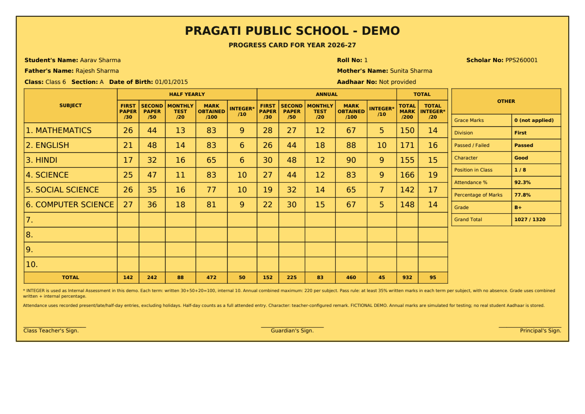
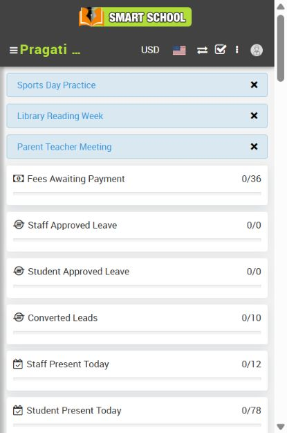
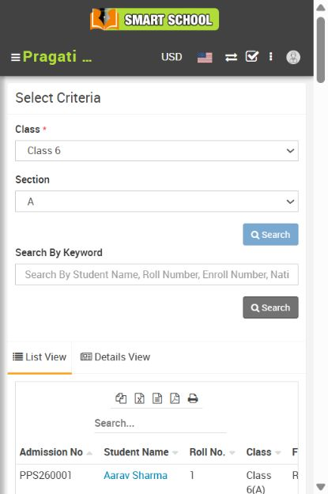
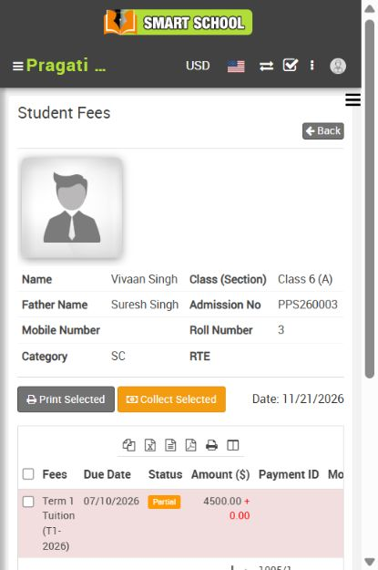
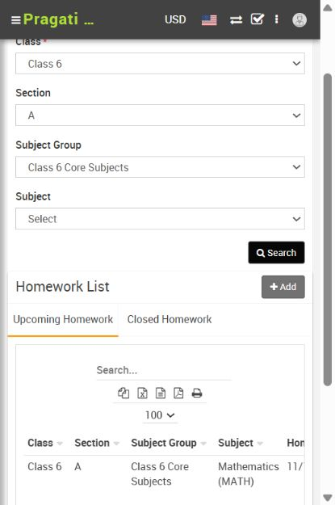
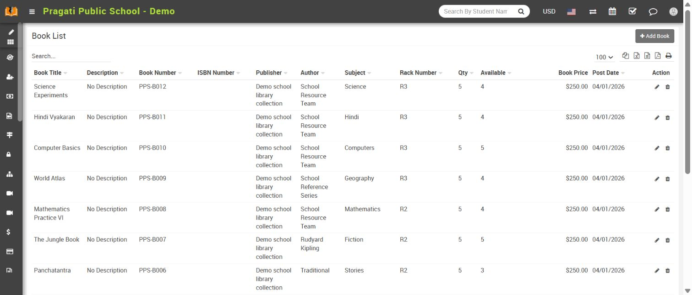

# Smart School Management System — Runnable Interview Demo

**Complete PHP/CodeIgniter school ERP source, a fictional demonstration database, local launchers and a custom annual progress-card workflow.**

Prepared and customized by **Dhanish Kumar Maurya** using the supplied **QDOCS Smart School 7.1.0** application and its 11 add-on modules. The underlying ERP and add-ons are third-party products; the additional progress-card implementation, integration work, demonstration setup and QA are described separately. Original attribution and license-verification files are retained. See [third-party notice](THIRD-PARTY-NOTICE.md).



## Live interview demo

**[Open Staff / Super Admin Demo](https://smart-school-interview-demo.onrender.com/site/login)** · **[Student / Parent Demo](https://smart-school-interview-demo.onrender.com/site/userlogin)** · **[All role logins and live walkthrough](docs/LIVE-DEMO.md)**

Render Free hosts an isolated, fictional school demonstration. All eight representative roles are available. Initial wake-up can take about a minute, and changes reset with the ephemeral container. Public maintenance actions are restricted. See the live guide for credentials, hosted checks and limits.

## What you can run

- The full application in `app/`, including its bundled PHP dependencies and add-on files.
- `database.sql` with **80 fictional students, 40 parent accounts and 11 staff** across Classes 6–10, Sections A/B, for session **2026–27**.
- Student/parent/staff logins and demonstration records for admissions, attendance, fees, homework, examinations, courses, library, HR and front office.
- A custom **Half Yearly + Annual progress card**, assessment mappings, totals, grades, pending-result handling and single/bulk PDF generation.
- A Windows/XAMPP launcher and a Docker Compose setup for Windows, macOS or Linux.

**VS Code is an editor.** Open this repository in VS Code, then start one of the PHP/database runtimes below. The VS Code Live Server extension cannot execute this PHP application or provide its database.

## Quick start: Windows with XAMPP

1. Install a compatible XAMPP build with PHP 8.2 and MariaDB, normally at `C:\xampp`.
2. Clone this repository or download and extract its ZIP to a short, writable path such as `C:\SchoolERP`.
3. Double-click **`Start-SmartSchool.cmd`** in the project root.
4. Wait for database initialization/import to complete. On the first run, the launcher prints a generated administrator password; keep that local value if you need the initial owner account.
5. Open **http://127.0.0.1:18097/site/login**.
6. For the prepared interview demonstration, use `demo.superadmin@pragati.example` with password **`Demo@School2026!`**.

The launcher starts its own loopback-only PHP and MariaDB instances. It uses web port **18097** and database port **33318**, and stores its runtime state under the ignored `runtime/` directory. Run the launcher again after restarting Windows; existing records are reused.

If XAMPP is installed elsewhere, run this from the project folder in PowerShell:

```powershell
powershell.exe -NoProfile -ExecutionPolicy Bypass -File .\Start-SmartSchool.ps1 -XamppPath "D:\xampp"
```

The separate XAMPP Control Panel Apache/MySQL services are not required for this launch method. See the detailed [Hindi local setup guide](docs/LOCAL-SETUP-HINDI.md).

## Quick start: Docker Compose

Install and start Docker Desktop or Docker Engine with Compose. From the repository root:

```bash
python tools/create-env.py
docker compose up --build -d
docker compose ps
```

Use `python3` instead of `python` where appropriate. If Python is unavailable, copy `.env.example` to `.env` and fill its database passwords and application key with separate strong random values.

When the services are healthy, open:

- Staff: **http://127.0.0.1:8080/site/login**
- Students/parents: **http://127.0.0.1:8080/site/userlogin**

The database is private to the Compose network; no database port is published. Database records and uploads use named volumes. The SQL snapshot imports only when the database volume is initially empty.

**Verification:** Local Compose configuration has been validated. The separate Render-specific Docker image has also built and run successfully on Render Free; its hosted role/PDF and selected business-workflow checks are recorded in [the live guide](docs/LIVE-DEMO.md). The local two-container Compose stack has not been runtime-tested on this machine.

## Automated local smoke check

With the native application running, execute `python tools/smoke-test.py http://127.0.0.1:18097`. For Docker, use port `8080`. This fixture check exercises eight logins, representative pages and two PDF routes. See [verification details](docs/VERIFICATION.md).

## Demo role accounts

These are intentionally public **fictional local-demo accounts**, all using **`Demo@School2026!`**. Never reuse them for a real school or production deployment.

| Role | Username | Suggested demonstration |
|---|---|---|
| Super Admin | `demo.superadmin@pragati.example` | Dashboard, students, staff, reports and configuration |
| Admin | `admin@pragati.example` | Admissions, timetable, leave approval and examinations |
| Teacher | `teacher@pragati.example` | Attendance, homework evaluation, lesson plan and leave |
| Accountant | `accountant@pragati.example` | Outstanding fees, cash receipt, bank requests and expense records |
| Librarian | `librarian@pragati.example` | Book availability, issue, return and overdue history |
| Receptionist | `reception@pragati.example` | Enquiry follow-up, visitors, phone log and complaints |
| Student | `student.004` | Pending homework submission, exam, course and fee dues |
| Parent | `parent.001` | Switch between siblings and compare attendance, fees and homework |

`student.001` is Aarav Sharma's evaluated-work example. `student.004` has pending homework suitable for submission. `parent.001` is linked to `student.001` and `student.041`. See [demo accounts and presentation sequence](docs/DEMO-LOGINS.md).

The initial `admin@smartschool.test` account uses the private password generated by the Windows launcher, rather than a published owner password. The seeded demo Super Admin above is the convenient local demonstration account.

## Demonstration data and workflows

| Area | Prepared examples |
|---|---|
| Student records | 80 enrollments, siblings, profiles and active/disabled status examples |
| Academics | Classes 6–10, A/B sections, subjects, class teachers and weekly timetable |
| Fees | Paid/partial/unpaid installments, receipts, discounts, transport dues and six pending bank requests |
| Attendance | Historical entries and students ready for a new day's marking |
| Homework | Pending, submitted and evaluated work across 20 homework records |
| Examinations | Half Yearly results, upcoming assessment, practice online exam and CBSE records |
| Courses | Three free courses with lessons, quizzes, assignments and enrollments |
| Library | Twelve book titles, members and issued/returned/overdue examples |
| Administration | Online admission applications, enquiries, visitors, calls, complaints, leave, payroll, inventory, hostel and transport |

## Custom progress card

The optional photo-style template combines two terms in one landscape A4 report. It maps **eight assessment exams in total**: First Paper, Second Paper, Monthly Test and Internal Assessment for each term.

The sample rules are explicit: each term uses **30 + 50 + 20 written marks plus 10 internal marks per subject**. The paper's “Integer” label means Internal Assessment in this configuration. These are demonstration rules, not a universal grading scheme. Missing required marks produce **Pending**, not a fabricated pass.

Class 6-A contains assessment examples for this format. Existing marksheet templates remain separate. School name, assessment mappings and remarks are configured through **Photo Progress Card Settings**; marks are entered through the host examination workflow.

## Screenshots

All shown school/student records are fictional. Application screenshots show the mobile-width browser view; the progress-card image shows the landscape print layout.

| Dashboard | Students |
|---|---|
|  |  |

| Fees | Homework |
|---|---|
|  |  |



## Technology and included add-ons

PHP 8.2-compatible application code, CodeIgniter, MariaDB/MySQL, Bootstrap, jQuery and the bundled mPDF integration. Composer/vendor dependencies included with the supplied application are retained; a normal clone does not start by replacing them with unrelated dependency versions.

The supplied installation includes **Behaviour Records, CBSE Examination, Google Meet Live Class, Multi Branch, Online Course, QR Code Attendance, Quick Fees Create, Thermal Print, Two-Factor Authentication, WhatsApp Messaging and Zoom Live Class**.

Provider integrations still require their own credentials/configuration. Firebase's real service-account credential and a hardcoded Maps key are not included in this public package. Use `firebase_notification_key.example.json` as a configuration template and `GOOGLE_MAPS_API_KEY` for Maps configuration. Real payment settlement, provider-created Zoom/Meet sessions, WhatsApp delivery and physical scanner/printer output are separate tests.

## Verification and hosting status

Recorded local verification includes **43 role-login/selected-page checks**, consistency checks on the fictional dataset, normal marksheet PDF generation and parent sibling selection. The custom progress-card checks covered settings save, a one-student PDF, an eight-student bulk PDF, pending marks and an existing-template regression. This does not mean every submenu and every possible operation has passed full end-to-end acceptance.

**The public interview demo is live on Render Free.** See [role logins and hosted verification](docs/LIVE-DEMO.md). The app runs in an isolated, resettable PHP/MariaDB container; GitHub itself remains the source and documentation host.

## Source layout

```text
app/                       Full application and bundled dependencies
database.sql               Fictional demonstration snapshot
Start-SmartSchool.cmd      Windows local launcher
Start-SmartSchool.ps1      XAMPP-based isolated local runtime
router.php                 Local PHP routing and private-path guards
Dockerfile
compose.yaml               PHP/Apache plus private MariaDB
docker/                    Container configuration
tools/create-env.py        Local secret generation
docs/                      Setup, accounts and deployment guidance
```

For the separately documented customization module, see [SmartSchool Progress Card Customizations](https://github.com/dhanishmaurya0001-gif/SmartSchool-Progress-Card-Customizations).

## Attribution and use

The maintainer has confirmed authorization to publish the supplied source package. That statement does not replace the original component licenses, grant a new universal license to third-party products, or establish that every component is MIT-licensed. Retain original notices and apply the terms relevant to your intended use. Personal provider credentials, local machine state and real school data are excluded.

Maintainer: [Dhanish Kumar Maurya](https://github.com/dhanishmaurya0001-gif).
